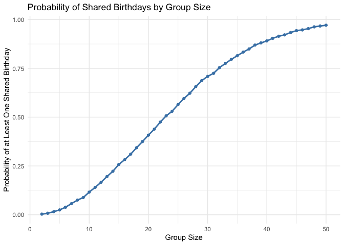
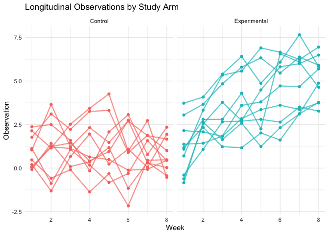
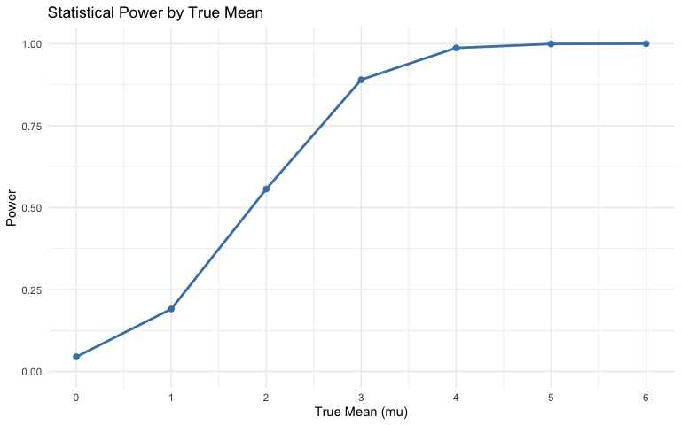
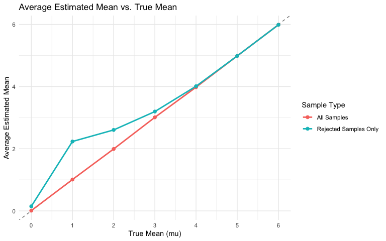

P8105 Homework 5
================
Xiaohan Qiang

# Problem 1

``` r
# Function to check whether at least two people share a birthday
birthday_sim = function(n) {
  birthdays = sample(1:365, size = n, replace = TRUE)
  any(duplicated(birthdays))
}

# Run 10,000 simulations for each group size
set.seed(123)

birthday_results = 
  tibble(group_size = 2:50) |>
  mutate(
    probability = map_dbl(
      group_size,
      ~ mean(replicate(10000, birthday_sim(.x)))
    )
  )

# Plot the estimated probabilities
birthday_results |>
  ggplot(aes(x = group_size, y = probability)) +
  geom_line(color = "steelblue", linewidth = 1) +
  geom_point(color = "steelblue", size = 1.5) +
  labs(
    title = "Probability of Shared Birthdays by Group Size",
    x = "Group Size",
    y = "Probability of at Least One Shared Birthday"
  ) +
  theme_minimal()
```

<!-- -->

The probability of at least two people sharing a birthday increases with
group size. At around 23 people, the probability exceeds 50%,
illustrating the birthday paradox. By 50 people, the probability is
approximately 97%. The increase gradually slows as the probability
approaches 1.

# Problem 2

``` r
# List all participant files
file_df = tibble(
  file_name = list.files(
    path = "data",
    pattern = "\\.csv$"
  )
)

# Read each participant's data using purrr::map
participant_data = file_df |>
  mutate(
    data = map(
      file_name,
      ~ read_csv(
        file.path("data", .x),
        show_col_types = FALSE
      )
    )
  )

# Extract subject ID and study arm, then tidy weekly observations
longitudinal_data = participant_data |>
  mutate(
    arm = case_when(
      str_starts(file_name, "con") ~ "Control",
      str_starts(file_name, "exp") ~ "Experimental"
    ),
    subject_id = str_remove(file_name, "\\.csv$") |>
      str_remove("^(con|exp)_")
  ) |>
  select(subject_id, arm, data) |>
  unnest(data) |>
  pivot_longer(
    cols = starts_with("week"),
    names_to = "week",
    values_to = "observation",
    names_prefix = "week_"
  ) |>
  mutate(
    week = as.numeric(week),
    arm = factor(arm, levels = c("Control", "Experimental"))
  )

# Spaghetti plot
longitudinal_data |>
  ggplot(
    aes(
      x = week,
      y = observation,
      group = interaction(arm, subject_id),
      color = arm
    )
  ) +
  geom_line(alpha = 0.7, linewidth = 0.8) +
  geom_point(size = 1.5) +
  facet_grid(. ~ arm) +
  labs(
    title = "Longitudinal Observations by Study Arm",
    x = "Week",
    y = "Observation",
    color = "Study Arm"
  ) +
  theme_minimal() +
  theme(legend.position = "none")
```

<!-- -->

The spaghetti plot shows distinct trends between the two study arms.
Observations in the control group fluctuate over time without a clear
upward or downward trend. In contrast, most participants in the
experimental group show increasing observations over the eight weeks.
Although there is individual variability within both groups, the
experimental group demonstrates a more pronounced upward trend compared
with the relatively stable control group.

# Problem 3

``` r
# Set simulation parameters
set.seed(123)

n = 30
sigma = 5
mu_values = 0:6
n_sim = 5000

# Function to simulate one dataset and perform a t-test
simulate_t_test = function(mu) {
  sample_data = rnorm(n, mean = mu, sd = sigma)

  t.test(sample_data, mu = 0) |>
    broom::tidy() |>
    select(estimate, p.value)
}

# Run 5000 simulations for each true mean
simulation_results =
  tibble(mu = mu_values) |>
  mutate(
    results = map(
      mu,
      \(true_mu) map_dfr(
        1:n_sim,
        \(i) simulate_t_test(true_mu)
      )
    )
  ) |>
  unnest(results) |>
  mutate(rejected = p.value < 0.05)

# Calculate statistical power
power_results =
  simulation_results |>
  group_by(mu) |>
  summarize(
    power = mean(rejected),
    .groups = "drop"
  )

# Plot power against true mean
power_results |>
  ggplot(aes(x = mu, y = power)) +
  geom_line(color = "steelblue", linewidth = 1) +
  geom_point(color = "steelblue", size = 2) +
  labs(
    title = "Statistical Power by True Mean",
    x = "True Mean (mu)",
    y = "Power"
  ) +
  scale_x_continuous(breaks = mu_values) +
  scale_y_continuous(limits = c(0, 1)) +
  theme_minimal()
```

<!-- -->

``` r
# Calculate average estimates across all and rejected samples
estimate_results =
  simulation_results |>
  group_by(mu) |>
  summarize(
    all_samples = mean(estimate),
    rejected_samples = mean(estimate[rejected]),
    .groups = "drop"
  ) |>
  pivot_longer(
    cols = c(all_samples, rejected_samples),
    names_to = "sample_type",
    values_to = "mean_estimate"
  ) |>
  mutate(
    sample_type = recode(
      sample_type,
      all_samples = "All Samples",
      rejected_samples = "Rejected Samples Only"
    )
  )

# Compare average estimates with true means
estimate_results |>
  ggplot(aes(
    x = mu,
    y = mean_estimate,
    color = sample_type
  )) +
  geom_abline(
    slope = 1,
    intercept = 0,
    linetype = "dashed",
    color = "gray50"
  ) +
  geom_line(linewidth = 1) +
  geom_point(size = 2) +
  labs(
    title = "Average Estimated Mean vs. True Mean",
    x = "True Mean (mu)",
    y = "Average Estimated Mean",
    color = "Sample Type"
  ) +
  scale_x_continuous(breaks = mu_values) +
  theme_minimal()
```

<!-- -->
